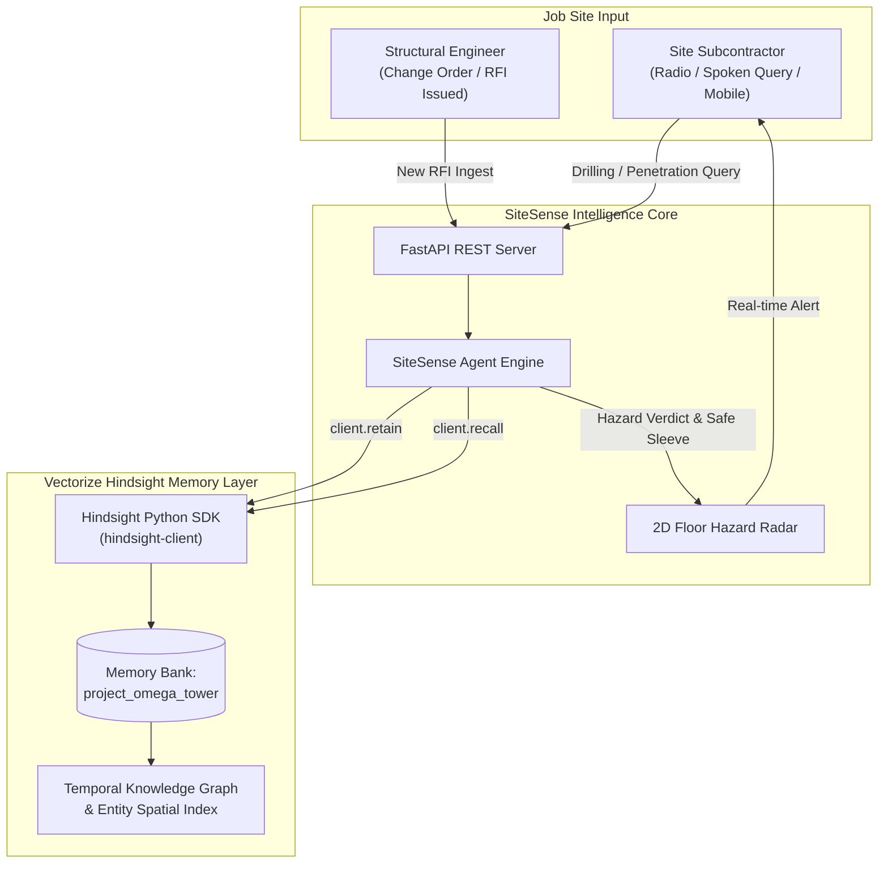

# 🏗️ SiteSense RFI: Zero-Rework Construction Agent
> **Autonomous Construction Safety Agent powered by [Vectorize Hindsight](https://vectorize.io/what-is-agent-memory) persistent memory.**  
> *Prevents catastrophic job-site errors, severed post-tension tendons, and multimillion-dollar rework by remembering months of architectural RFIs.*

---

## 🎯 The Multi-Billion Dollar Problem

In commercial high-rises and civil infrastructure, **construction rework accounts for over $31.3 Billion annually in the US alone** (FMI Construction Report). Over 52% of rework is caused by miscommunication, obsolete drawings, and field changes that never reach the sub-trade workers.

### The Real-World Disaster Scenario:
1. **Month 1 (Base Plan Rev-0):** Level 3 concrete floor slab at Grid B-4 is drawn as standard 8-inch reinforced concrete.
2. **Month 2 (Structural Change via RFI-104):** Structural engineer issues RFI-104 adding high-tension **post-tensioning (PT) tendons** pressurized to 33,000 lbs across Grid B-4 to mitigate cantilever deflection. Core drilling is strictly prohibited.
3. **Month 4 (The Disaster):** A plumbing subcontractor drills a 4-inch core hole for a drain line using standard blueprints or a stateless AI chatbot. The tendon is severed, the cantilever sags, the building is evacuated, and emergency repairs cost **$185,000**.

### Why Stateless AI & Standard RAG Fail:
Standard vector search treats documents as static text chunks. It has **no concept of temporal precedence** (that RFI-104 issued in March overrides drawing Rev-0 from January) or **spatial entity relationships** (that Grid B-4 anchors physical safety directives).

---

## 💡 The Solution: Cognitive Agent Memory with Hindsight

**SiteSense RFI** uses [Vectorize Hindsight](https://github.com/vectorize-io/hindsight) as an external cognitive memory engine:
- **`client.retain()`**: Ingests RFIs, engineering bulletins, and field revisions into temporal memory banks with spatial tags (`Level 3`, `Grid B-4`).
- **`client.recall()`**: When a field worker asks a question via site radio or mobile dashboard, the agent retrieves the most recent governing engineering directives in milliseconds.
- **`Zero-Rework Guidance`**: The agent halts hazardous work immediately and provides pre-approved alternative pathways (e.g., diverting to designated MEP sleeve at Grid B-6).

---

## 🏛️ System Architecture



---

## ⚡ Quickstart in 60 Seconds

### 1. Prerequisites
- Python 3.10+
- (Optional) Free credits for Hindsight Cloud: Register at [ui.hindsight.vectorize.io](https://ui.hindsight.vectorize.io) and apply promo code **`MEMHACK99`** in the billing tab for **$50 free credits**.

### 2. Installation
```bash
# Clone the repository
git clone https://github.com/your-username/sitesense-rfi.git
cd sitesense-rfi

# Install dependencies
pip install -r requirements.txt
```

### 3. Configure Credentials (Optional)
Copy `.env.example` to `.env`:
```bash
cp .env.example .env
```
*(Note: SiteSense includes a built-in high-fidelity local memory emulator, so it runs completely out-of-the-box even without cloud keys!)*

### 4. Launch Interactive Web Dashboard
```bash
python3 run.py web
```
Open your browser to: **`http://localhost:8000`**

### 5. Run Interactive Rich Terminal Demo
```bash
python3 run.py demo
```

---

## 📊 Benchmark: Stateless AI vs. SiteSense with Hindsight

| Scenario | Worker Question | Without Hindsight (Stateless AI) | With Hindsight (SiteSense) | Rework Cost Prevented |
| :--- | :--- | :--- | :--- | :--- |
| **Post-Tension Tendon Clash** *(Level 3, Grid B-4)* | *"Can I core drill 4-inch hole through slab?"* | **APPROVED.** "Base drawings show solid slab. Core drill allowed." 💥 **Tendon severed.** | **🚨 STOP WORK.** Recalled RFI-104 (Month 2). Diverted to safe sleeve at Grid B-6. | **$185,000** |
| **480V Feeder Busway Strike** *(Level 2, Grid C-2)* | *"Can I install 75mm anchor bolts into drywall?"* | **APPROVED.** "Non-bearing drywall partition. 75mm anchors OK." ⚡ **Arc flash explosion.** | **⚡ STOP WORK.** Recalled RFI-112. Busway behind wall. Fastener depth capped to 25mm. | **$95,000** |
| **2-Hour Firestop Breach** *(Level 4, Corridor E-3)* | *"Do I seal sleeve penetration with standard caulk?"* | **APPROVED.** "Standard acoustical sealant OK on drawings." ❌ **Occupancy inspection fails.** | **🔥 CAUTION.** Recalled RFI-145. Upgraded to 2-Hour Fire Wall. UL collar required. | **$42,000** |
| **Total Cumulative Savings** | | | | **$322,000** |

---

## 💻 Code Walkthrough: Hindsight Integration

### 1. Retaining Construction RFIs (`client.retain`)
```python
from hindsight_client import Hindsight

client = Hindsight(
    base_url="https://api.hindsight.vectorize.io",
    api_key=os.getenv("HINDSIGHT_API_KEY")
)

def retain_rfi(rfi, bank_id="project_omega_tower"):
    client.retain(
        bank_id=bank_id,
        content=rfi.to_hindsight_content(),
        metadata={"rfi_id": rfi.id, "level": rfi.level, "grid": rfi.grid_location},
        tags=[rfi.id.lower(), rfi.grid_location.lower(), "critical-safety"],
        document_id=rfi.id
    )
```

### 2. Field Hazard Recall (`client.recall`)
```python
def check_work_hazard(question, level, grid, bank_id="project_omega_tower"):
    # Semantic & temporal recall across memories
    memories = client.recall(
        bank_id=bank_id,
        query=f"{question} {level} {grid}",
        max_tokens=2048
    )
    # Evaluates recalled structural directives against proposed action
    return evaluate_hazard(memories)
```

---

## 🧪 Automated Test Suite

Run the full automated pytest suite:
```bash
python3 run.py test
```
```
collected 8 items
tests/test_agent.py ....                                                 [ 50%]
tests/test_api.py ....                                                   [100%]
========================= 8 passed in 0.16s =========================
```

---

## 📁 Repository Structure

```
├── run.py                 # Unified CLI and server entrypoint
├── article.md             # 1,140-word technical publication draft
├── requirements.txt       # Project dependencies
├── pytest.ini             # Pytest configuration
├── src/
│   ├── agent.py           # SiteSense Zero-Rework Agent logic
│   ├── config.py          # Environment settings
│   ├── dataset.py         # Realistic construction RFIs & benchmark cases
│   ├── memory.py          # Vectorize Hindsight memory manager & fallback
│   ├── models.py          # Pydantic schemas (RFIDocument, WorkerQuery)
│   ├── server.py          # FastAPI REST endpoints
│   └── cli.py             # Rich terminal simulation interface
├── static/
│   └── index.html         # Interactive Floor Hazard Radar Dashboard
├── tests/
│   ├── test_agent.py      # Unit tests for hazard recall & dynamic learning
│   └── test_api.py        # API integration tests
└── docs/
    ├── linkedin_post.md   # High-CTR Andrej Karpathy style LinkedIn post
    ├── video_script.md    # 3-minute screen-recorded demo script & YouTube titles
    └── thumbnail_prompt.md# Nano Banana viral thumbnail prompt (16:9)
```

---

## 🏆 Official Resources

- [Vectorize Hindsight GitHub](https://github.com/vectorize-io/hindsight)
- [Hindsight Documentation](https://hindsight.vectorize.io/)
- [What is Agent Memory?](https://vectorize.io/what-is-agent-memory)
- [Hindsight Cloud Console](https://ui.hindsight.vectorize.io) *(Use promo code `MEMHACK99` for $50 free credits)*

---
*Built with ❤️ for zero-rework, safe job sites.*
