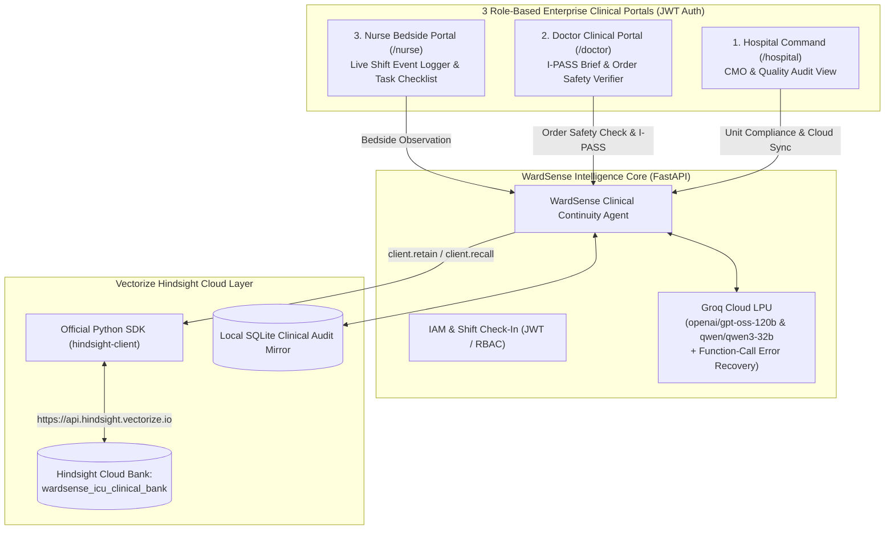

# 🏥 WardSense ICU: Zero-Drop Clinical Shift-Handoff & Continuity Engine

> **Autonomous Clinical Continuity & I-PASS Shift-Handoff Platform powered by [Vectorize Hindsight](https://vectorize.io/what-is-agent-memory) persistent memory and Groq LPU reasoning.**  
> *Eliminates the 80% shift-change communication gap across Hospital Administration, Attending Physicians, and Bedside ICU Nurses.*

---

## 🎯 The Multi-Billion Dollar Clinical Problem

According to the Joint Commission, **over 80% of serious preventable medical errors in hospitals occur during clinical shift handoffs** (when nurses and resident doctors rotate every 8 to 12 hours).
An Intensive Care Unit (ICU) patient passes through **10+ nurses and 4+ on-call physicians** over a 5-day stay. Critical bedside events—such as a 02:00 AM hypokalemic ventricular arrhythmia after an IV diuretic bolus, a delayed beta-lactam anaphylactoid reaction, or an anesthesia epidural anticoagulation hold—get buried inside 60-page EHR flowcharts before the 07:00 AM morning rounds.

### Why Stateless EHR Summarizers & Standard RAG Fail:
Standard stateless AI only evaluates the current prompt or static admission summary:
- **Without Memory (Stateless AI):** Sees `+1,450 mL` fluid overload on Day 4 and approves *IV Furosemide 80mg stat bolus*—unaware that 38 hours ago during Night Shift #5, an IV Furosemide bolus caused the patient's serum potassium to crash to `2.7 mEq/L`, triggering Ventricular Tachycardia.
- **With Hindsight Memory (WardSense ICU):** Uses [Hindsight](https://github.com/vectorize-io/hindsight) (`client.retain()` and `client.recall()`) to maintain a temporal clinical memory bank across shifts. It blocks the dangerous order in milliseconds, cites the exact shift nurse observation from 38 hours prior, and surfaces the Electrophysiology-approved continuous Bumetanide + KCl protocol.

---

## 🏛️ System Architecture



---

## 🖥️ Role-Based Portals & Features

1. **Clinical IAM Sign-In & Registration (`/login`, `/register`):**
   - Full JWT session authentication, PBKDF2 password hashing, medical license badge ID tracking, and active shift check-in.
   - Includes **1-Click Role Switcher Cards** so evaluators can switch between **Hospital CMO (`/hospital`)**, **Attending Doctor (`/doctor`)**, and **ICU Charge Nurse (`/nurse`)** in one click.
2. **Portal 1 — Hospital Command Center (`/hospital`):**
   - Live 4-Bed High-Acuity ICU Telemetry Matrix (`ICU-BED-04`, `ICU-BED-07`, `ICU-BED-11`, `ICU-BED-15`).
   - Prevented Adverse Drug Event (ADE) ROI counter (`$199,500` / `~₹1.67 Cr` avoided liability).
   - Hospital-wide Vectorize Hindsight Memory Bank Audit Log & 1-Click Cloud Sync.
3. **Portal 2 — Doctor Clinical Continuity Workstation (`/doctor`):**
   - **Side-by-Side Order Contraindication Verifier:** Compares *Stateless EHR AI* vs. *WardSense with Hindsight Memory* live.
   - **Temporal Learning Curve Simulator (`Shift 1 -> Shift 5 -> Shift 20`):** Demonstrates how agent clinical precision grows from `38%` at Shift #1 (baseline) to `78%` at Shift #5 (adverse reaction learned) to `98%` at Shift #20 (longitudinal mastery).
   - **Automated I-PASS Shift Handoff Synthesizer:** Generates standardized *Illness Severity, Patient Summary, Action List, Situation Awareness, and Synthesis* briefs.
4. **Portal 3 — Nurse Bedside & Shift Handoff Workstation (`/nurse`):**
   - Real-time bedside event logger that executes `client.retain()` against Hindsight Cloud and auto-creates cross-shift follow-up tasks for incoming clinicians.

---

## ⚡ Quickstart & Hindsight Cloud Setup (`MEMHACK99`)

### 1. Install Dependencies
```bash
pip install -r requirements.txt
```

### 2. Configure Hindsight Cloud & Groq (Optional via `.env` or Live UI Modal)
1. Register at **[https://ui.hindsight.vectorize.io](https://ui.hindsight.vectorize.io)** and apply promo code **`MEMHACK99`** in Billing for **$50 in free credits**.
2. Copy `.env.example` to `.env` and add your keys (or configure them live inside the web UI's **Hindsight Cloud Configuration Modal**):
```bash
cp .env.example .env
```

### 3. Launch Web Platform, CLI Demo, or Tests
```bash
# Start the Multi-Portal Web Server at http://localhost:8000
python3 run.py web

# Run the Rich Terminal Demonstration (for screenshots & CLI inspection)
python3 run.py demo

# Run the End-to-End Automated Test Suite
python3 run.py test
```

### 4. Band AI Desktop Integration
Open `/Users/luvkushkumar/Documents/RFI` in **Band AI Desktop** (`https://www.band.ai`). Band AI automatically reads [`band.json`](band.json) to orchestrate the web server, CLI demo, and health checks.

---

## 📚 Official Documentation & Links
- **Hindsight GitHub Repository:** [https://github.com/vectorize-io/hindsight](https://github.com/vectorize-io/hindsight)
- **Hindsight Official Documentation:** [https://hindsight.vectorize.io/](https://hindsight.vectorize.io/)
- **What is Agent Memory (Vectorize):** [https://vectorize.io/what-is-agent-memory](https://vectorize.io/what-is-agent-memory)
